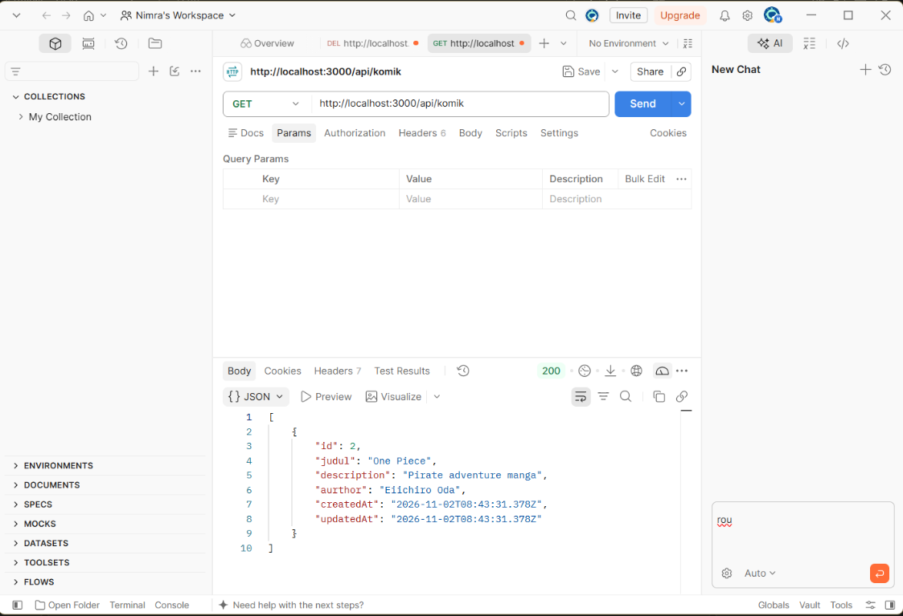
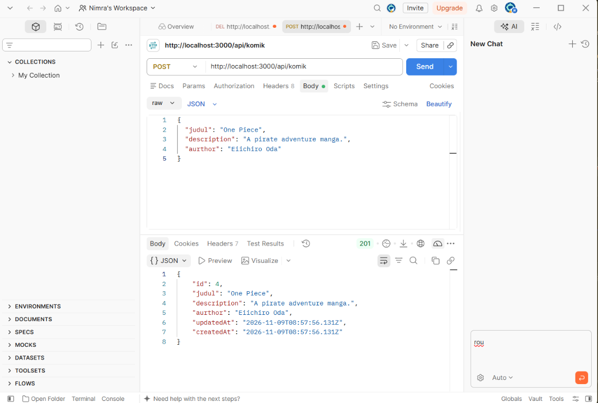
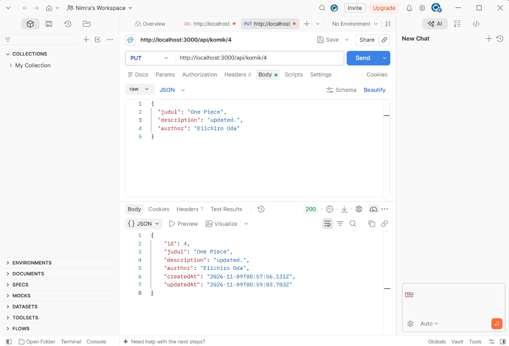
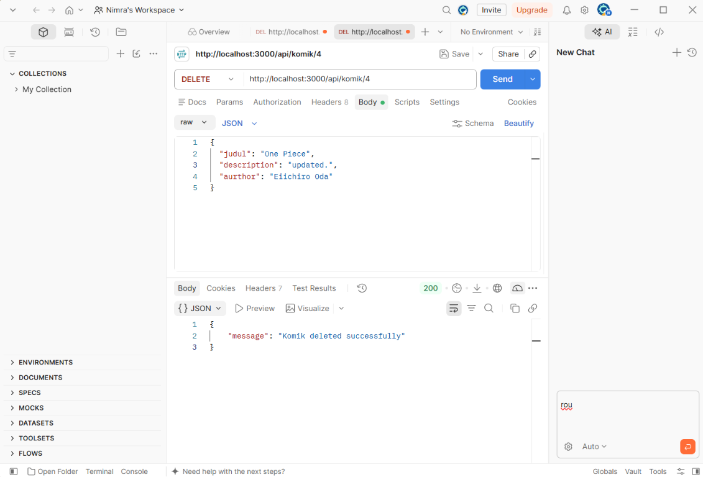

# Komik API

A small REST API for managing comic records, built with Express, Sequelize, and PostgreSQL.

## Run locally

1. Install dependencies with `npm install`.
2. Create a PostgreSQL database and add these settings to `.env`:

   ```env
   DB_USER=your_user
   DB_PASS=your_password
   DB_DATABASE=your_database
   DB_HOST=localhost
   DB_PORT=5432
   DB_DIALECT=postgres
   ```

3. Start the server with `npm start`. It listens on `http://localhost:3000`.

## API

All routes use `/api/komik`. Create and update requests accept JSON with `judul`, `description`, and `aurthor`.

| Method | Path | Action |
| --- | --- | --- |
| GET | `/api/komik` | List comics |
| GET | `/api/komik/:id` | Get a comic |
| POST | `/api/komik` | Create a comic |
| PUT | `/api/komik/:id` | Update a comic |
| DELETE | `/api/komik/:id` | Delete a comic |

## Screenshots

**GET** — list comics  


**POST** — create a comic  


**PUT** — update a comic  


**DELETE** — delete a comic  

